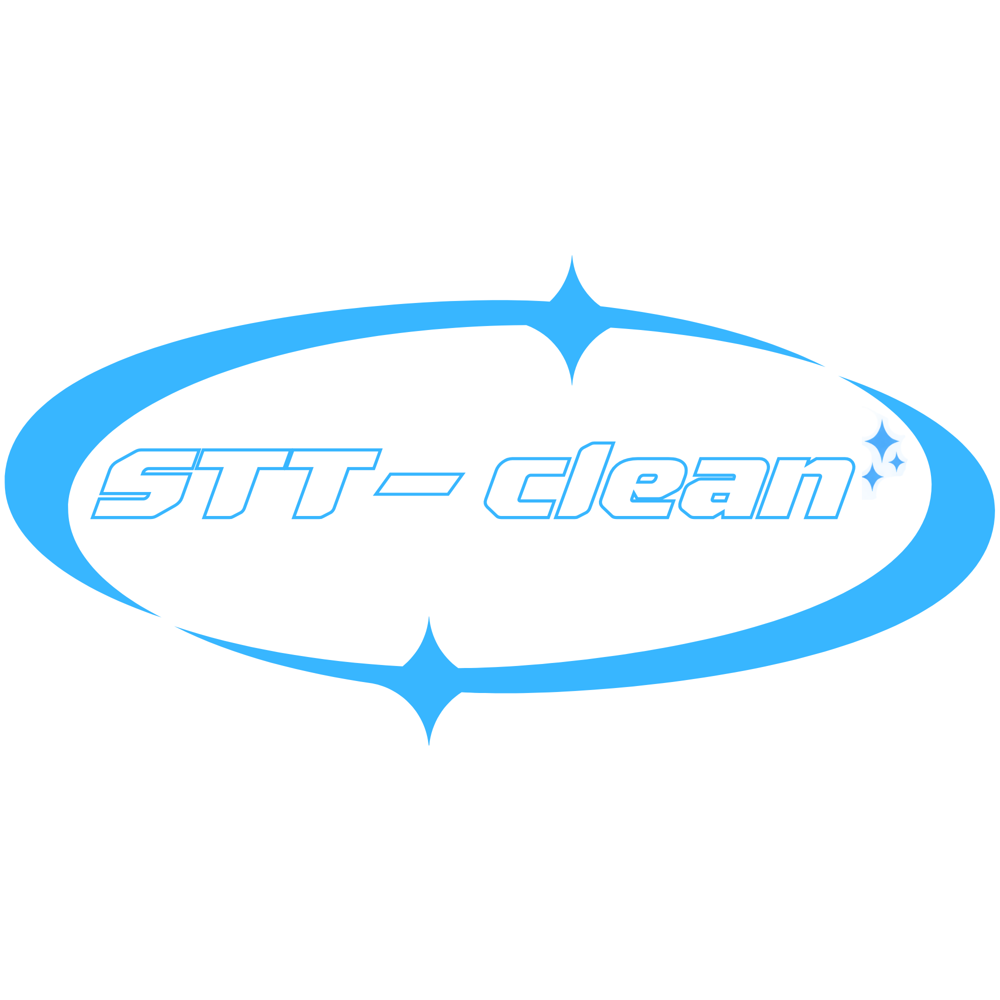

# STT-Clean: offline dictation for macOS, typed into any app


STT-Clean is a menu-bar app that types what you say into whatever app you're in. It is a wrapper
around models you already have: it finds the speech models on your Mac (Parakeet or Whisper, run
with MLX on Apple silicon) and the LLMs in Ollama or LM Studio, and puts them in two menus, one click
to switch. As you speak, a live draft appears at the cursor. When you stop, the LLM handles spoken
corrections ("scratch that"), punctuation ("comma", "new line") and translation ("write it in
English"), and the cleaned text replaces the draft. Nothing leaves your Mac, and STT-Clean never
downloads a model. On an M4 with Parakeet TDT 0.6B v3, 44 s of speech transcribes in 1.2 s, and
`gemma4:12b-mlx` cleans a short sentence in 0.7–2 s.

## Install

You need a Mac with Apple silicon (M1 or newer), macOS 14 or newer, and Python 3.12 or newer
(get it from [python.org](https://www.python.org/downloads/macos/) or `brew install python`).

```bash
git clone https://github.com/riccardoroselli/STT-Clean.git
cd STT-Clean
./install.sh
```

`install.sh` installs the app's Python packages (not models) into a `.venv` folder inside the
project (~0.5 GB), then builds `build/STT-Clean.app` and opens it. If you already have a Python
environment with the packages in `src/requirements.txt`, use it instead:
`STT_CLEAN_PYTHON=/path/to/python ./install.sh`.

When the icon appears in the menu bar:

1. **Allow Accessibility** when macOS asks. STT-Clean needs it to type the text.
2. **Allow the Microphone** on your first dictation.
3. **Right-click the icon.** **Speech** and **LLM** list the models found on your Mac; the one in
   use is ticked. If a list is empty, see [Models](#models).

To start it at login, add `build/STT-Clean.app` in System Settings → General → Login Items.
To update: `git pull`, then `./install.sh` again.

## Usage

| Action | How |
|---|---|
| Dictate | Click the menu-bar icon, speak, click again. A clock shows the recording time. |
| Cancel | Press Esc while recording: the live text is erased and nothing is pasted. |
| Menu | Right-click the icon |
| Change speech model | Menu → **Speech** → click a model. It lists the models on this Mac that are ready to use. |
| Change LLM | Menu → **LLM** → click a model. It lists every model in Ollama and LM Studio, if they are running. |
| Smart clean-up | Menu switch. Turn it off for the raw transcript (this also frees the LLM's memory). |
| Live text while speaking | Menu switch. Turn it off to type only the final text. |
| Custom spellings | Menu → **Edit Glossary…** ([below](#glossary)) |

A switch takes effect immediately and is remembered. If a model can't be used, the menu says
why and the previous one stays. Only one LLM is in memory at a time; it is freed when you switch,
turn clean-up off or quit.

Keystrokes only go to the app, window and text field where the dictation started. If you
switch away, typing pauses and resumes when you come back. If you're still away when the
dictation ends, the text is copied to the clipboard instead.

## Voice commands

The LLM follows these in Italian and English:

| Kind | Say | Result |
|---|---|---|
| Self-correction | "Tuesday at five, scratch that, Wednesday" · "actually no" · "no cancella" · "anzi" | Only the corrected version is kept |
| Punctuation | "comma", "period" · "virgola", "punto", "due punti", "punto interrogativo" | `,` `.` `:` `?` |
| Layout | "new line" / "a capo" · "new paragraph" / "nuovo paragrafo" | Line break / blank line |
| Translation | "… write it in English" · "scrivilo in inglese" · "traduci in inglese" | Whole text translated, instruction removed |
| Partial translation | "solo la prossima frase traducimela in inglese" | Only the next sentence translated |

Questions and requests are pasted as text, not answered.

## Glossary

For names, brands and jargon the speech model gets wrong, open Menu → **Edit Glossary…** and add
one term per line:

```
Ollama: o lama, olama
GitHub: git hub
Kubernetes
```

The variants after the colon are replaced exactly, before the LLM runs. Every term is also given
to the LLM, which fixes close mis-hearings from context. Changes apply from the next dictation.

## Models

STT-Clean doesn't install models. It uses what is already on your Mac, checked every time you open
the menu, so a model you add appears without a restart.

| Kind | Found where | Picked at launch |
|---|---|---|
| Speech | The Hugging Face cache (`~/.cache/huggingface/hub`, or `$HF_HOME/hub`): Parakeet and Whisper models in MLX format (`mlx-community/…`). Other formats aren't found: whisper.cpp / MacWhisper `.bin`, faster-whisper, OpenAI `.pt`, Transformers `openai/whisper-*`. | Your last pick, else Parakeet TDT 0.6B v3, else the first one found |
| LLM | Every chat model in [Ollama](https://ollama.com) and [LM Studio](https://lmstudio.ai), while they are running | Your last pick, else `gemma4:12b-mlx`, else the first one found |

No speech model yet? Download one with the Hugging Face CLI that comes with the app's packages,
for example:

```bash
.venv/bin/hf download mlx-community/parakeet-tdt-0.6b-v3      # 2.3 GB, 25 European languages, fastest
.venv/bin/hf download mlx-community/whisper-large-v3-turbo    # 1.6 GB, ~100 languages, slower
```

No LLM? Smart clean-up is optional: without it you get the raw transcript. For it, install Ollama
and run `ollama pull gemma4:12b-mlx` (~8 GB of RAM while loaded), or download any model in LM
Studio. Any instruct model works; `tests/bench_llm.py` checks how well it follows the commands.

With Whisper, the live draft updates less often: it re-transcribes the whole clip about twice a
second, and Whisper is slower than Parakeet.

## Troubleshooting

| Problem | Fix |
|---|---|
| The live text or the final text never appears | Turn STT-Clean on in System Settings → Privacy & Security → Accessibility. The menu's status line warns about this. |
| The app does nothing when opened, from an external drive | Allow STT-Clean in Privacy & Security → Files & Folders → Removable Volumes. |
| "No speech model found" | Download one ([Models](#models)), then pick it in the menu → Speech. |
| "Ollama isn't running" in the menu | Open Ollama (or LM Studio), or turn Smart clean-up off. |
| A model "didn't work" | Some models answer the text instead of cleaning it, or think too long. Try another one; `gemma4:12b-mlx` passes all 16 checks in `tests/bench_llm.py`. |
| Anything else | The log of the current run is `logs/stt-clean.log`. |

Every rebuild (`./install.sh`) resets the app's permissions, because macOS identifies an
unsigned app by its exact contents; allow them again on the next launch. To reset the menu
choices, run `defaults delete com.riccardoroselli.stt-clean`.

To uninstall: run that `defaults delete` command and delete the folder. Your models stay where
they are.

## How it works

| Step | What happens | Where |
|---|---|---|
| Record | The mic opens on click and closes on stop. Esc is a global hot key only while recording. | `src/menubar.py`, `src/audio.py`, `src/esc_key.py` |
| Live draft | Every ≥0.5 s the whole clip so far is re-transcribed. Only words that two consecutive drafts agree on are typed, so the text grows instead of flickering. | `src/stt.py`, `src/live.py` |
| Final pass | The clip is transcribed once more, then the glossary's variants are replaced. | `src/stt_clean.py`, `src/cleanup.py` |
| Clean-up | The LLM (temperature 0, thinking off) applies the voice commands. On any failure, or an answer that looks wrong, the raw text is used. | `src/cleanup.py` |
| Replace | Only the changed tail of the draft is erased; the rest is pasted with ⌘V. The previous clipboard (text, images, files) is restored once the app has read the paste. | `src/output.py` |

With Parakeet, re-transcribing the whole clip takes ~0.25 s at 10 s of audio, ~0.5 s at 30–40 s
and ~0.9 s at 50 s. Parakeet uses ~1.3 GB of RAM; its working cache is freed after each dictation.

## Project structure

```
install.sh             One-step install: Python packages in .venv, then the app
src/                   The app (Python, ~1150 lines)
  stt_clean.py         Entry point and worker loop: record → live draft → final → clean → paste
  stt.py               Speech engines (Parakeet, Whisper on MLX), finds the models on this Mac
  menubar.py           Menu-bar icon, menu, Speech/LLM lists, switches, saved choices, status line
  audio.py             Mic stream opened per recording, resampling, sounds
  live.py              Live-draft logic: which words to type, minimal erase/append diff
  output.py            Keystrokes, focus check (app/window/field), clipboard save/restore, ⌘V
  esc_key.py           Esc as a global hot key while recording (no extra permission)
  cleanup.py           LLM client (Ollama, LM Studio), system prompt, glossary, fallbacks
  requirements.txt     Pinned dependencies
macos/                 App bundle: build_app.sh, launcher.c (starts Python so permissions belong
                       to the app), Info.plist, AppIcon.icns and make_icon.py
tests/                 Unit tests, LLM benchmark, manual end-to-end checks
assets/                Logo and 1024 px app icon
```

`.venv/`, `build/`, `logs/` and your `config/glossary.txt` are created locally and not tracked.

## Development

```bash
.venv/bin/python src/stt_clean.py --no-paste            # run from a terminal: log there, text printed, not typed
.venv/bin/python -m unittest discover tests             # 31 unit tests: live-draft logic, glossary, LLM servers, engines, settings
.venv/bin/python tests/bench_llm.py [model ...]         # 16 realistic dictations through the LLM picked in the menu
.venv/bin/python tests/e2e_pipeline.py                 # macOS `say` → speech model → LLM, no mic
.venv/bin/python tests/typing_check.py                  # replays heavy draft churn into TextEdit (takes the keyboard ~15 s)
```

`--debug` keeps the last dictation's audio and live drafts in `logs/debug/` so it can be replayed.
`bench_llm.py` is the regression test for the prompt (`SYSTEM_PROMPT` in `src/cleanup.py`):
`gemma4:12b-mlx` passes 16/16. Rerun it after changing the prompt or before relying on a new model.

## Limitations

- Dictation starts and stops with a mouse click only; there's no keyboard shortcut, and Esc only cancels.
- Secure input fields (passwords, terminals with Secure Keyboard Entry) block typing and pasting.
- Chrome and Electron apps (VS Code) don't report their focused text field, so switching tabs
  inside one of their windows during a dictation isn't detected.
- A clipboard manager that reads the clipboard before the target app does counts as the paste,
  so the old clipboard can come back too early.
- The LLM rewrites the whole text: long dictations take ~1 s per 20–25 words. Turn Smart clean-up
  off for raw speed.
- Commands work as phrased in the prompt; there is no general voice-command engine.

## Licence

[MIT](LICENSE). The models are not part of this repo and keep their own licences, e.g.
[Parakeet TDT 0.6B v3](https://huggingface.co/nvidia/parakeet-tdt-0.6b-v3) (NVIDIA) and
[Gemma](https://ollama.com/library/gemma4) (Google).
